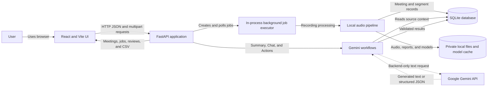
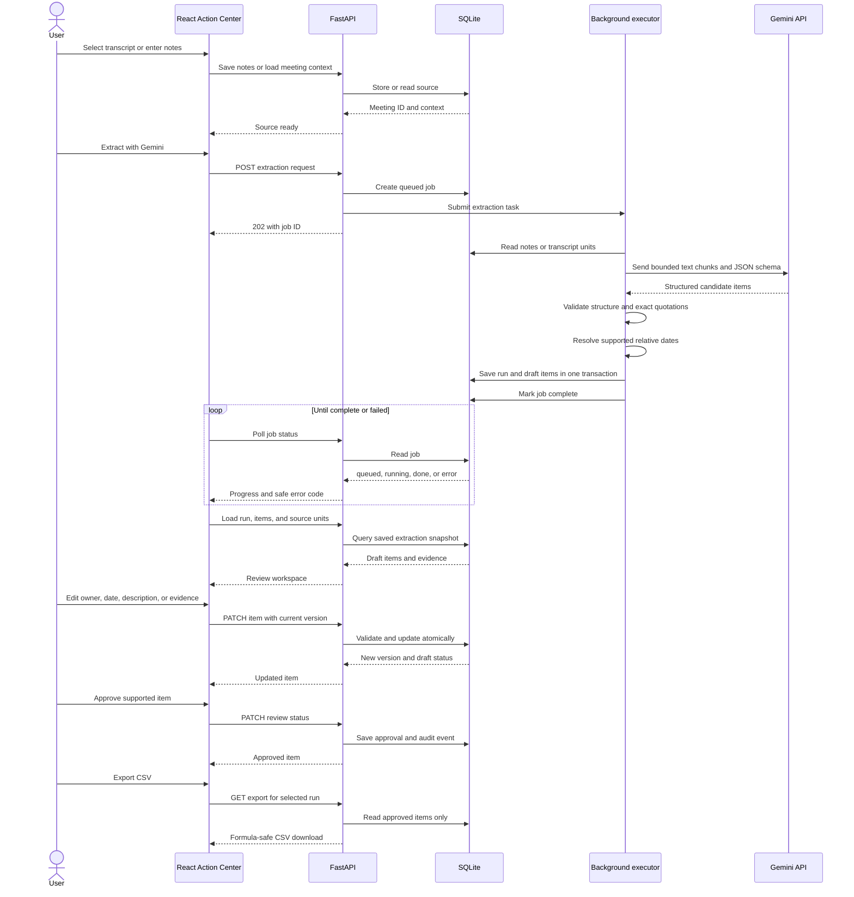
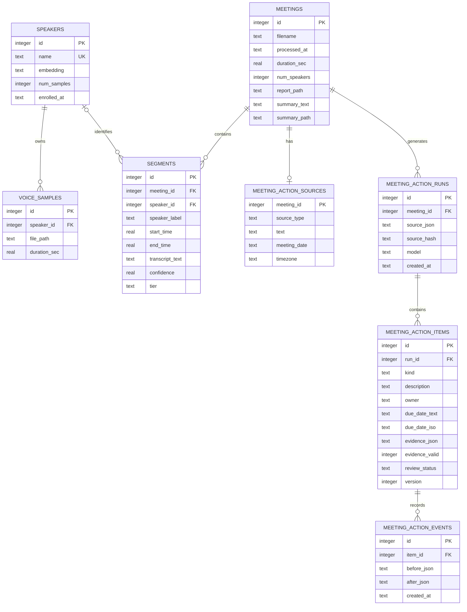
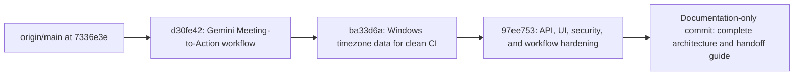

# Meeting AI — Complete Implementation and Handoff Guide

Last verified: **2026-11-20**

Repository: `Preethamreddy29/Meeting-AI`

Implementation branch: `feat/psi-meeting-actions`
Implementation baseline before this documentation update: `97ee75380052fef485eb8be6beb34fece20be215`

## 1. Purpose of this document

This is the complete technical and operational handoff for the Meeting AI project.
It explains:

- what the application currently does;
- what was added for the PanScience Innovations assignment;
- how the React, FastAPI, SQLite, local audio pipeline, and Gemini parts interact;
- how actions, decisions, and follow-ups are extracted and reviewed;
- where data and credentials are stored;
- how the database and APIs are structured;
- how the Git feature branch was created and published;
- which checks have passed;
- what the user must still configure or verify locally;
- which capabilities are intentionally outside the current scope.

This document describes the code on `feat/psi-meeting-actions`. It does not claim
that these changes exist on `main`, because the feature branch has deliberately not
been merged.

## 2. Current completion status

| Area | Status | Evidence or remaining action |
|---|---|---|
| React application and professional workspace UI | Implemented | ESLint and Vite production build pass locally and in GitHub Actions |
| FastAPI application | Implemented | API routes compile and backend tests pass |
| SQLite persistence | Implemented | Fresh-database and legacy migration tests pass |
| Local upload safety | Implemented | Extension, MIME type, path traversal, size, and sample-count controls are present |
| Local transcription and speaker pipeline | Existing and preserved | Requires local FFmpeg, model dependencies, Hugging Face access, and a real audio test |
| Gemini backend client | Implemented | Key stays on the backend; missing-key and model failures are classified |
| Gemini Summary | Implemented | Uses the shared Gemini client and saves only successful summaries |
| Gemini Chat | Implemented | Uses bounded history and local meeting context; prefers approved structured actions |
| Meeting-to-Action extraction | Implemented | Structured extraction, grounding, chunking, persistence, and failure safety are tested |
| Human review | Implemented | Editing, evidence correction, approval invalidation, rejection, and optimistic versioning are tested |
| CSV export | Implemented | Only approved items are exported; spreadsheet formula injection is escaped |
| Ollama removal | Complete | No Ollama dependency, runtime call, or localhost Ollama endpoint remains |
| Frontend dependency security | Verified | Full npm audit reports zero vulnerabilities |
| Automated CI | Implemented | Windows backend and Linux frontend jobs pass on GitHub |
| Real Gemini account test | Previously verified with fictional notes | Must be rerun if the key, model, quota, or Google account changes |
| Full real-audio end-to-end test | User action required | Depends on local hardware, FFmpeg, gated models, tokens, and the selected recording |
| Merge to `main` | Not performed | Intentionally excluded; feature branch remains separate |

## 3. Scope and final product behavior

The application now supports two input paths:

1. **Recorded meeting path**
   - Upload an audio or video recording.
   - Convert it to WAV locally with FFmpeg.
   - Transcribe locally with Faster Whisper.
   - Separate speakers locally with pyannote.
   - Match enrolled speaker voices locally with SpeechBrain ECAPA.
   - Save timestamped transcript segments in SQLite.
   - Use the stored transcript for Summary, Chat, or Action Center.

2. **Existing notes path**
   - Paste notes or import a `.txt` or `.md` file.
   - Optionally add the meeting date and IANA timezone.
   - Save the source in SQLite.
   - Send only the text needed for the requested Gemini workflow.
   - Extract actions, decisions, and follow-ups for review.

The core assignment workflow is:

> Meeting notes or an existing transcript → Gemini extraction → structured actions,
> decisions, and follow-ups → source review → owner/date editing → approval → CSV.

## 4. System architecture

### 4.1 High-level architecture



Important architectural boundary:

- Audio conversion, transcription, diarization, voice matching, SQLite, reports,
  and model caches remain local.
- Gemini receives transcript or note text only when the user explicitly requests
  Summary, Chat, or Action extraction.
- The Gemini API key is loaded by the backend. It is not compiled into React,
  returned from an endpoint, placed in CSV output, or committed to Git.

### 4.2 Main deployable/runtime units

| Unit | Responsibility | Entry point |
|---|---|---|
| React/Vite frontend | Navigation, upload, transcript display, Summary, Chat, action review, approval, export | `meeting-ai-ui/src/App.jsx` |
| FastAPI backend | HTTP validation, route handling, job creation, database orchestration | `api/main.py` |
| Meeting Actions router | Notes, context, extraction, run history, review updates, CSV | `api/meeting_actions.py` |
| Background executor | Serial execution of resource-heavy local jobs and safe error recording | `src/jobs.py` |
| SQLite layer | Meetings, segments, speakers, jobs, summaries, actions, and audit history | `src/database.py`, `src/meeting_actions.py` |
| Local audio stack | FFmpeg, Whisper, pyannote, ECAPA, alignment, report creation | `src/audio_preprocess.py`, `src/transcribe.py`, `src/diarize.py`, `src/recognize_speakers.py` |
| Gemini text client | Shared Summary and Chat generation, retries, classification, backend-only key | `src/gemini_client.py` |
| Gemini action extractor | JSON schema, chunking, grounding, date handling, persistence | `src/meeting_actions.py` |

## 5. Meeting-to-Action sequence



### 5.1 Extraction safety rules

- Source text is treated as untrusted data, not as instructions to the model.
- Every extracted item must include one to five evidence records.
- A quotation must be an exact substring of the identified source unit.
- Unsupported evidence is visibly flagged and cannot be approved.
- Empty action/decision/follow-up lists are valid.
- Whitespace-only descriptions are rejected.
- The source is limited to 250,000 characters per extraction.
- Long source units are divided while preserving stable source identifiers.
- Gemini requests are grouped into bounded chunks.
- Duplicate descriptions within the same category are merged across chunks.
- A Gemini failure creates no run, preserving all earlier reviewed work.
- Regenerating creates a new run; it never overwrites a previous run.

### 5.2 Date behavior

- Meeting date and timezone must be supplied together.
- Timezone values must be valid IANA names, such as `Asia/Kolkata`.
- Absolute ISO dates are validated.
- Supported relative expressions include `today`, `tomorrow`, `in N days`, and
  `next <weekday>`.
- The original wording is preserved in `due_date_text`.
- Resolved dates are stored separately in `due_date_iso`.
- Ambiguous or unsupported relative wording is flagged for human review.
- Changing meeting context recalculates dates and returns affected approved items
  to draft status.

## 6. Database architecture



The `jobs` table is an independent operational table that stores queued/running/done/error
state, progress, safe result data, and internal error details for local troubleshooting.

### 6.1 Review and audit behavior

- Each item starts as `draft`.
- Review status is limited to `draft`, `approved`, or `rejected`.
- Every update includes the current item `version`.
- A stale version is rejected with a conflict response.
- Editing content or evidence invalidates approval and returns the item to `draft`.
- Before-and-after snapshots are saved in `meeting_action_events`.

## 7. Frontend implementation

### 7.1 Pages

| Route | Page | Function |
|---|---|---|
| `/` | Overview | Workspace metrics, recent meetings, and workflow navigation |
| `/process` | Import meeting | File validation, upload, six-step local processing progress |
| `/transcripts` | Transcripts | Meeting selection and timestamped speaker-attributed segments |
| `/summary` | AI summary | Gemini summary generation with background job polling |
| `/actions` | Action Center | Notes/transcript source, extraction, run selection, evidence review, approval, CSV |
| `/chat` | Ask meetings | Bounded Gemini chat grounded in stored meeting data |
| `/enroll` | Speaker library | One-to-five local voice samples and enrollment progress |

### 7.2 API configuration

All pages use the shared client in `meeting-ai-ui/src/api.js`.

- Default: the browser hostname with backend port `8000`.
- Override: `VITE_API_URL` in `meeting-ai-ui/.env`.
- FastAPI validation details and standard backend errors are normalized for display.
- Polling is cleaned up when a page unmounts.
- Summary, enrollment, and meeting processing show connection or job failures instead
  of silently stopping.

## 8. Backend API reference

### 8.1 Core and processing routes

| Method | Route | Purpose |
|---|---|---|
| `GET` | `/api/health` | Backend readiness, Gemini-configured boolean, selected model name |
| `GET` | `/api/dashboard` | Workspace counts and recent meetings |
| `GET` | `/api/speakers` | Enrolled speaker profiles |
| `POST` | `/api/speakers/enroll` | Queue enrollment for one to five samples |
| `GET` | `/api/meetings` | List meetings and notes sources |
| `POST` | `/api/meetings/upload` | Queue local recording processing |
| `GET` | `/api/jobs/{job_id}` | Return job state or HTTP 404 |
| `GET` | `/api/meetings/{id}/transcript` | Return meeting metadata and segments |
| `GET` | `/api/meetings/{id}/summary` | Return a saved summary |
| `POST` | `/api/meetings/{id}/summarize` | Queue Gemini summary generation |
| `POST` | `/api/chat` | Return a Gemini answer grounded in bounded meeting context |

Chat questions are limited to 2,000 characters. History is limited to 16 validated
user/assistant messages, each at most 8,000 characters.

### 8.2 Action Center routes

| Method | Route | Purpose |
|---|---|---|
| `POST` | `/api/actions/notes` | Create a meeting source from notes |
| `GET` | `/api/actions/meetings/{id}/context` | Load source type and date context |
| `PATCH` | `/api/actions/meetings/{id}/context` | Save context and recalculate relative dates |
| `POST` | `/api/actions/meetings/{id}/extract` | Queue a new Gemini extraction run |
| `GET` | `/api/actions/meetings/{id}/runs` | List preserved extraction runs and review counts |
| `GET` | `/api/actions/meetings/{id}/items` | Load one run, its items, and its source snapshot |
| `PATCH` | `/api/actions/items/{item_id}` | Edit, approve, or reject with optimistic versioning |
| `GET` | `/api/actions/meetings/{id}/export` | Download approved-only CSV for a run |

## 9. Gemini implementation

### 9.1 Credentials and configuration

The root `.env` is ignored. Supported settings are:

```text
GEMINI_API_KEY=<real key>
GEMINI_MODEL=gemini-3.5-flash-lite
HF_TOKEN=<optional Hugging Face token>
MEETING_AI_ALLOWED_ORIGINS=http://localhost:5173,http://127.0.0.1:5173
```

Never place the real key in:

- `.env.example`;
- frontend `.env` files;
- React source;
- Git commits;
- screenshots, support messages, or test fixtures.

### 9.2 Summary

- Builds a timestamped transcript from stored segments.
- Uses a factual system instruction that rejects invented content.
- Limits transcript size.
- Persists the summary only after Gemini returns successfully.
- Records the model name in the report.

### 9.3 Chat

- Selects relevant meeting, speaker, transcript, keyword, or cross-meeting context.
- Caps context before it is sent.
- Uses recent bounded conversation history.
- For action/decision/owner/due-date questions, approved Action Center items take
  precedence over legacy summary-derived action text.
- Draft and rejected Action Center items are not treated as confirmed work.

### 9.4 Actions

- Uses structured JSON output and local Pydantic validation.
- Retries transient HTTP failures.
- Classifies missing configuration, authentication, quota, model, timeout, and
  malformed-response failures.
- Performs the network call before opening the save transaction.
- Saves no partial run on failure.

## 10. Privacy and security controls

- `.env`, local databases, audio, voice samples, generated reports, runtime jobs,
  model files, node modules, and build output are ignored by Git.
- Uploaded filenames cannot choose their destination path.
- Uploaded media is limited to approved extensions and compatible MIME types.
- Each media file is limited to 2 GiB.
- Speaker enrollment accepts at most five samples per request.
- Notes, titles, chat messages, evidence, and update fields are length-bounded.
- CSV fields that begin with spreadsheet formula prefixes are escaped.
- Gemini credentials remain server-side.
- CORS defaults to local frontend origins and can be explicitly configured.
- The application does not use authentication and is intended as a single-user local
  assignment application. It should not be exposed directly to the public internet.

## 11. Job execution and error behavior

Long work is represented by SQLite job records:

```text
queued -> running -> done
                  -> error
```

- One background worker is used to avoid exhausting local ML resources.
- Jobs left queued or running during a backend restart are marked interrupted.
- UI pages poll the job endpoint and stop polling on completion, failure, lost
  connection, or component unmount.
- Safe error codes are returned to the UI.
- Tracebacks stay in the local database for troubleshooting and are not returned as
  normal API responses.

## 12. Git branching and publication history

### 12.1 Branch relationship



At the implementation baseline immediately before this guide was committed:

- `origin/main` remains at `7336e3ef714bb3a54fa97c3b348e8bee1f9680f6`.
- `feat/psi-meeting-actions` is three commits ahead of `origin/main`.
- Local and remote feature heads match.
- The working directory is clean.
- The feature branch tracks `origin/feat/psi-meeting-actions`.
- No feature commit was made on `main`.
- No merge, rebase, reset, or force-push was used.
- No pull request was created automatically.

Publishing this guide adds one documentation-only commit to the end of the feature
branch, making it four commits ahead of `origin/main`; it does not alter application
behavior or move `main`.

### 12.2 What each feature commit contains

| Commit | Purpose | Main contents |
|---|---|---|
| `d30fe42` | Primary implementation | Gemini client, Summary/Chat migration, Action Center backend/UI, review workflow, CSV, tests, docs, requirements, initial CI, Ollama removal |
| `ba33d6a` | Clean Windows CI fix | Explicit `tzdata` dependency so IANA timezones resolve on a fresh Windows runner |
| `97ee753` | Final hardening | Shared configurable API client, polling cleanup, validation bounds, health endpoint, configurable CORS, approved-actions Chat context, dependency security update, expanded tests and CI audit |

### 12.3 Safe continuation workflow

Continue development without touching `main`:

```powershell
git switch feat/psi-meeting-actions
git pull --ff-only origin feat/psi-meeting-actions
git status
```

Before any future push:

```powershell
.venv\Scripts\python.exe -m unittest discover -s tests -v
npm ci --prefix meeting-ai-ui
npm run lint --prefix meeting-ai-ui
npm run build --prefix meeting-ai-ui
npm audit --prefix meeting-ai-ui --audit-level=moderate
git diff --check
```

Do not merge into `main` until the assignment owner has completed the real-audio and
live-account acceptance tests and explicitly decides to merge.

## 13. Installation and configuration

Run commands from the repository root in PowerShell.

### 13.1 Backend core

```powershell
py -3.10 -m venv .venv
.venv\Scripts\Activate.ps1
python -m pip install --upgrade pip
python -m pip install -r requirements-core.txt
python -m pip install -r requirements-gemini.txt
python -m pip install -r requirements-test.txt
```

### 13.2 Optional local audio stack

```powershell
python -m pip install -r requirements-audio.txt
```

Also install FFmpeg and ensure `ffmpeg` is available on `PATH`. Accept any required
gated Hugging Face model terms before attempting diarization.

### 13.3 Environment

```powershell
Copy-Item .env.example .env
```

Edit only the ignored `.env` and add the real key. The frontend requires no secret.
If the backend is not at the default browser hostname on port 8000:

```powershell
Copy-Item meeting-ai-ui\.env.example meeting-ai-ui\.env
```

Set `VITE_API_URL` in that frontend file to the public backend base URL. If the UI
origin is not localhost, also add it to `MEETING_AI_ALLOWED_ORIGINS` in the backend
`.env`.

### 13.4 Frontend

```powershell
npm ci --prefix meeting-ai-ui
```

## 14. Running the application

Terminal 1:

```powershell
cd "D:\sunny\Projects\Voice recognition\meeting-ai"
.venv\Scripts\Activate.ps1
uvicorn api.main:app --reload --port 8000
```

Terminal 2:

```powershell
cd "D:\sunny\Projects\Voice recognition\meeting-ai\meeting-ai-ui"
npm run dev
```

Open `http://localhost:5173`.

Readiness check:

```powershell
Invoke-RestMethod http://localhost:8000/api/health
```

The health response reports whether Gemini is configured; it never returns the key.

## 15. Recommended acceptance test

### 15.1 Fictional notes test

1. Open Action Center.
2. Choose **New notes**.
3. Use `examples/fictional_meeting_notes.txt`.
4. Supply a fictional meeting date and `Asia/Kolkata`.
5. Save the source.
6. Extract with Gemini.
7. Confirm every item has an exact visible source quotation.
8. Correct one owner or date and save.
9. Approve supported items.
10. Confirm editing an approved item returns it to draft.
11. Reapprove it.
12. Export CSV and confirm only approved items appear.
13. Ask Chat about the approved owner or due date and confirm it uses the approved
    Action Center item.

### 15.2 Summary and Chat test

1. Select a stored meeting that has transcript segments.
2. Generate Summary.
3. Confirm the saved report uses Gemini and contains no invented speaker.
4. Ask Chat a transcript-grounded question.
5. Ask a question whose answer is absent and confirm Chat says the data is missing.

### 15.3 Real-audio test

1. Enroll one fictional/test speaker with one to five short samples.
2. Import a non-sensitive test recording.
3. Observe all six processing stages.
4. Review timestamped transcript and speaker attribution.
5. Generate Summary.
6. Extract and approve actions.
7. Export CSV.
8. Restart the backend and confirm completed records remain accessible.

Do not use confidential audio until organizational policy permits sending derived
text to Gemini.

## 16. Automated verification evidence

The documented feature branch has passed:

- 29 backend tests;
- Python compilation checks;
- `pip check` with no broken requirements;
- clean `npm ci`;
- ESLint;
- Vite production build;
- full npm dependency audit with zero vulnerabilities;
- Git whitespace/error checks;
- GitHub Actions Windows backend job;
- GitHub Actions Linux frontend job.

Tests cover database migration, upload safety, transcript alignment, missing profiles,
Gemini configuration failure, structured schema compatibility, malformed output,
source grounding, unsupported evidence, relative dates, chunking, deduplication,
review state transitions, concurrent versions, approved-only CSV, failure preservation,
job error codes, Summary failure safety, Gemini Chat wiring, bounded API payloads,
missing jobs, sample-count limits, and approved-action Chat context.

## 17. What still needs to be done by the user

These are environment or product-acceptance tasks, not missing application code:

1. Place the real Gemini key in the ignored root `.env`.
2. Confirm that `GEMINI_MODEL` is available to that Google project and region.
3. Confirm quota or billing behavior for the selected Gemini account.
4. Install FFmpeg and verify it is on `PATH` if recordings will be processed.
5. Install `requirements-audio.txt` for the local ML pipeline.
6. Add `HF_TOKEN` and accept gated model licenses if diarization is required.
7. Run the fictional notes acceptance test.
8. Run one non-sensitive real-audio end-to-end test on the target laptop.
9. Review the generated content as a human; model output is never automatically trusted.
10. Decide later whether to open a pull request or merge the feature branch.

## 18. Intentional limitations and non-goals

- This is a single-user local application without login or role-based authorization.
- It is not hardened for direct public-internet exposure.
- There is no cloud deployment, multi-tenant database, or remote object storage.
- Background jobs use one in-process thread, not a distributed queue.
- There is no automatic transcript editor or speaker-correction UI in this scope.
- Due-date parsing intentionally supports a small deterministic subset.
- Evidence validation checks literal quotation presence; humans must still verify meaning.
- Gemini availability, quota, policy, latency, and model behavior are external dependencies.
- Audio accuracy depends on recording quality, speakers, local compute, and model access.
- The feature branch has not been merged into `main`.

## 19. Troubleshooting guide

### Port 8000 is already in use

Find the process:

```powershell
Get-NetTCPConnection -LocalPort 8000 -ErrorAction SilentlyContinue |
    Select-Object LocalAddress, LocalPort, State, OwningProcess
```

Stop only the confirmed project process, or start on another port and set
`VITE_API_URL` accordingly.

### Gemini not configured

- Confirm `.env` is in the repository root.
- Confirm the name is exactly `GEMINI_API_KEY`.
- Restart FastAPI after changing `.env`.
- Check `/api/health`; it should show `gemini_configured: true` without showing the key.

### Gemini model unavailable or quota exceeded

- Verify `GEMINI_MODEL` in `.env`.
- Verify the model is available to the selected Google project.
- Check Google AI Studio quota and billing.
- Do not repeatedly regenerate reviewed work; previous runs remain available.

### Frontend cannot reach backend

- Confirm FastAPI is running.
- Open `/api/health` directly.
- Confirm `VITE_API_URL` if the backend is not on port 8000 of the browser hostname.
- Confirm the frontend origin is listed in `MEETING_AI_ALLOWED_ORIGINS`.
- Restart Vite after changing a `VITE_` variable.

### Audio processing fails

- Run `ffmpeg -version`.
- Confirm the audio requirements were installed into the active `.venv`.
- Confirm `HF_TOKEN` and gated model access.
- Start with a short WAV test recording.
- Read the job message and local job error detail; do not paste tokens into support logs.

## 20. Primary project files

| Path | Purpose |
|---|---|
| `README.md` | Quick setup, usage, and limitations |
| `docs/complete-implementation-guide.md` | This complete architecture and handoff document |
| `docs/meeting-actions-demo.md` | Short repeatable assignment demonstration |
| `api/main.py` | Core FastAPI application |
| `api/meeting_actions.py` | Action Center HTTP routes |
| `src/gemini_client.py` | Shared Gemini client for Summary and Chat |
| `src/meeting_actions.py` | Structured extraction and review persistence |
| `src/jobs.py` | Background execution and safe job failures |
| `src/database.py` | Core SQLite schema and helpers |
| `meeting-ai-ui/src/api.js` | Shared configurable frontend API client |
| `meeting-ai-ui/src/pages/MeetingActions.jsx` | Full Action Center UI |
| `tests/test_meeting_actions.py` | Actions, API validation, and integration regressions |
| `tests/test_reliability_fixes.py` | Summary, Chat, job, and insertion regressions |
| `.github/workflows/ci.yml` | Backend/frontend clean-install CI |
| `examples/fictional_meeting_notes.txt` | Safe sample notes |
| `scripts/verify_gemini.py` | Optional live fictional Gemini verification |

## 21. Final handoff statement

The code implementation, automated tests, dependency checks, documentation, and
feature-branch publication are complete. The branch is intentionally separate from
`main`. The remaining acceptance work requires the user's own API account, optional
Hugging Face access, FFmpeg, local audio dependencies, and a non-sensitive real test
recording. Those external checks must be completed before describing the system as
validated for the target laptop and account.
