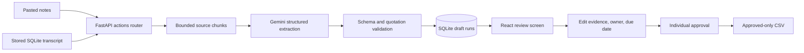

# Meeting-to-Action assignment demo

## Architecture

Whisper, diarization, speaker recognition, and SQLite remain local. Gemini is called
by the FastAPI backend when the user requests an Actions extraction, Summary, or Chat
answer. API credentials never enter the React application.

## Five-minute demonstration

1. Start FastAPI and the Vite frontend using the root README.
2. Open **Actions**.
3. Upload `examples/fictional_meeting_notes.txt` or paste its contents.
4. Set the date to `2026-10-27` and timezone to `Asia/Kolkata`.
5. Save the notes and click **Extract new draft with Gemini**.
6. Show the extracted categories and exact supporting quotations.
7. Change an owner, due date, or evidence quotation and save it.
8. Approve one item and show that editing it returns it to draft.
9. Reapprove it and download the CSV, showing that draft items are excluded.
10. Regenerate and show that the earlier reviewed run remains selectable.

## Expected safety behavior

- Missing or invalid keys produce an error run and save no extraction.
- Unsupported quotations are visibly flagged and cannot be approved.
- Correcting the source unit and exact quote revalidates the item.
- Long sources are divided into bounded requests and duplicate items are merged.
- Relative due dates are resolved only with both meeting date and timezone.
- Real keys remain in the ignored backend `.env`; never show the file during a demo.

## Verification boundary

Automated tests mock Gemini and use temporary databases. The optional live verifier
uses only fictional notes. Audio quality, Google quota/model access, and real-world
extraction quality must be checked on the presentation machine.
